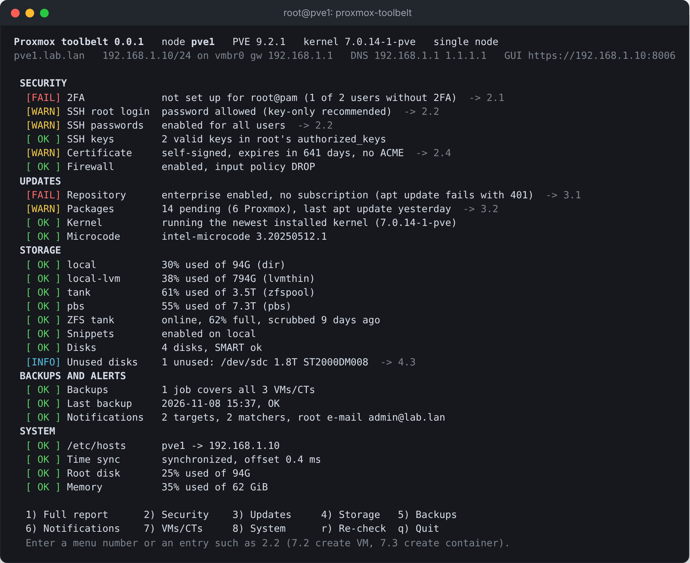
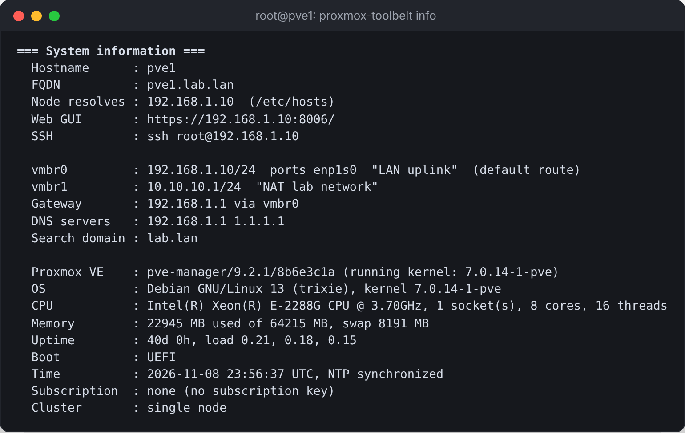
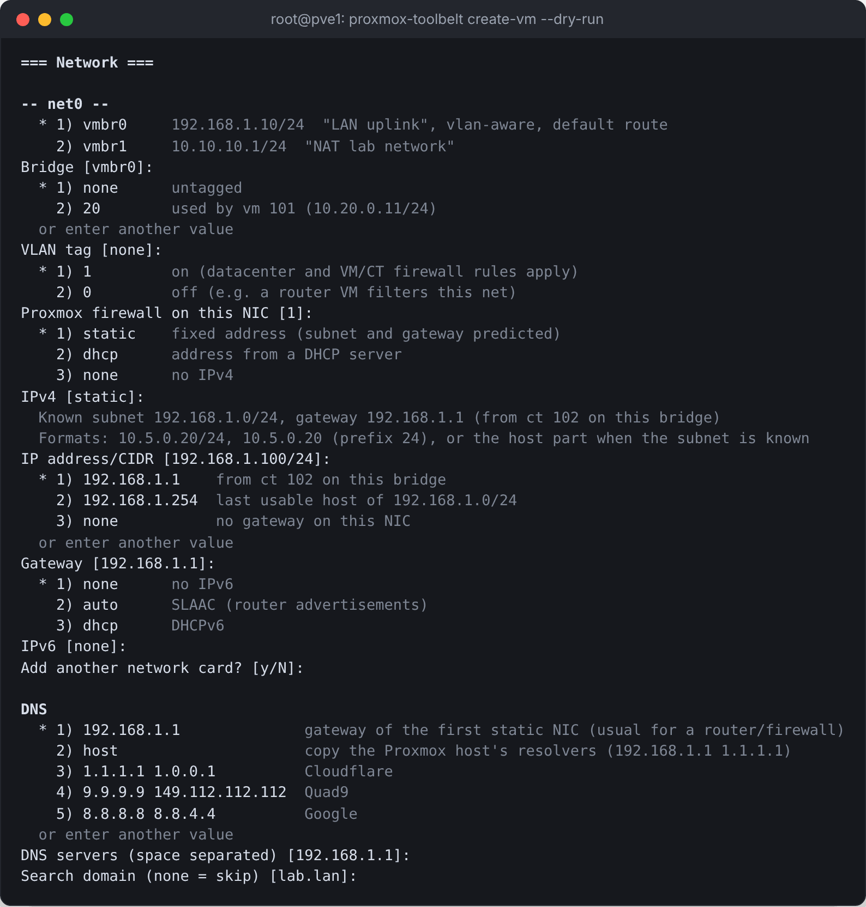
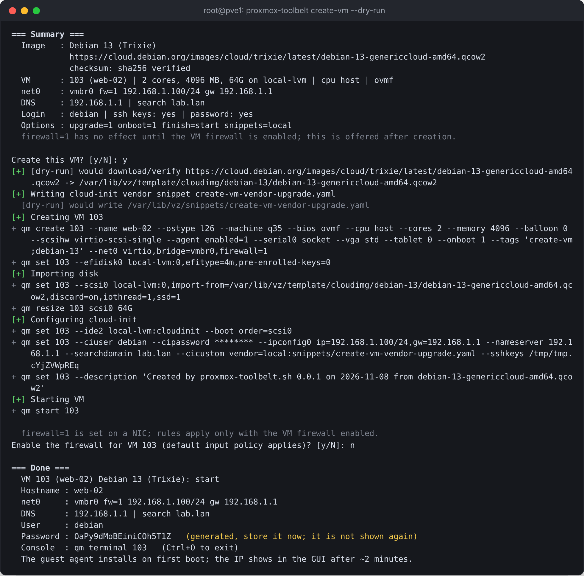
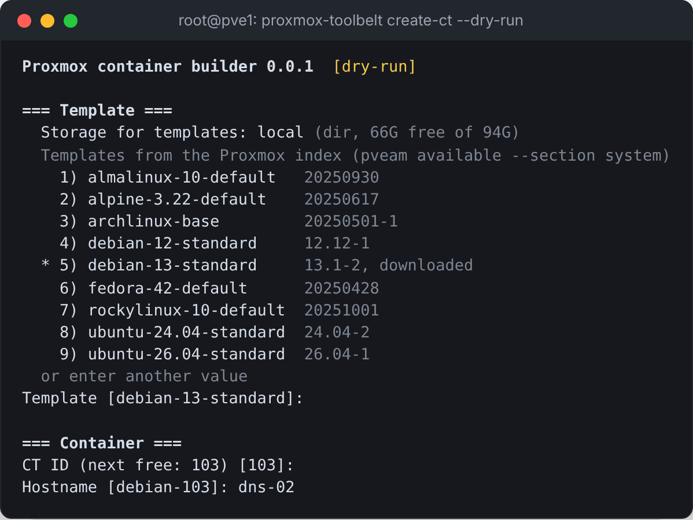
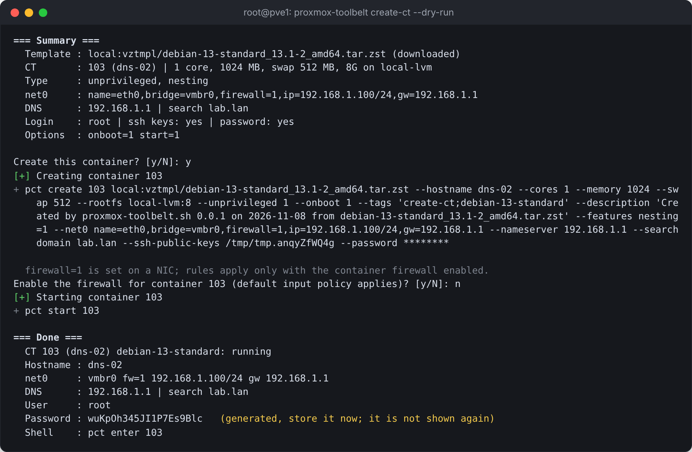

# Proxmox-Toolbelt

Interactive system checks and VM/CT launcher for the Proxmox VE 8/9 shell.

- **Status board:** read-only checks for 2FA, SSH, certificates, firewall, repositories,
  updates, storage, disks, backups and notifications.
- **Guided fixes:** every change shows a diff or the exact commands and asks first.
- **Builders:** cloud-init VMs, LXC containers and VM templates. Each prompt lists what the
  host actually has: storages, bridges, VLANs, free IP addresses and SSH keys.



The number after `->` opens the menu entry for that item.

## Install

On the Proxmox node, as root:

```bash
wget -qO /tmp/ptb.deb https://github.com/cfunkz/Proxmox-Toolbelt/releases/latest/download/proxmox-toolbelt_all.deb && apt install /tmp/ptb.deb
```

Then run `proxmox-toolbelt`, or `proxmox-toolbelt --dry-run` to look around without changing anything.

Remove it with `proxmox-toolbelt uninstall`, which also offers to remove caches and backups,
or with `apt purge proxmox-toolbelt`.

Without the package, the script runs on its own:

```bash
wget -O proxmox-toolbelt.sh https://raw.githubusercontent.com/cfunkz/Proxmox-Toolbelt/main/proxmox-toolbelt.sh
bash proxmox-toolbelt.sh
```

Releases include `SHA256SUMS` and a GitHub build attestation:
`gh attestation verify proxmox-toolbelt_all.deb -R cfunkz/Proxmox-Toolbelt`.

## Commands

| Command | Description |
|---------|-------------|
| `proxmox-toolbelt` | Status board and menu |
| `proxmox-toolbelt check` | Run the checks once. Exit code 0 = OK, 1 = warnings, 2 = failures |
| `proxmox-toolbelt check --json` | Check results as JSON, for monitoring |
| `proxmox-toolbelt info` | Hostname, addresses, gateway, DNS, GUI URL, hardware |
| `proxmox-toolbelt create-vm` | VM builder |
| `proxmox-toolbelt create-ct` | Container builder |
| `proxmox-toolbelt templates` | VM template builder |
| `proxmox-toolbelt uninstall` | Remove the program, defaults file, image cache and backups (each confirmed) |

Add `--dry-run` to any command to print the changes instead of applying them.

`proxmox-toolbelt info` (also menu 8.1):



## What it checks

| Area | Checks |
|------|--------|
| 2FA | Users without TOTP, WebAuthn or YubiKey; root@pam without 2FA; locked users; API tokens without privilege separation |
| SSH | Root login and password authentication (effective `sshd -T` values); valid and weak keys for root |
| Certificate | Self-signed or ACME; days until expiry |
| Firewall | Datacenter and node firewall; NICs with `firewall=1` whose VM/CT firewall is off |
| Repositories | Enterprise repository without a subscription; missing or test-only PVE repository; Ceph repository mismatch; wrong Debian suite; duplicates |
| Updates | Pending packages; stale package lists; reboot needed for a new kernel; interrupted dpkg run; CPU microcode |
| Storage | Usage per storage; inactive storage; LVM-thin metadata; ZFS pool health and scrub age |
| Disks | SMART status; SSD wear; unused disks; unused disk images in VM/CT configs |
| Backups | Backup jobs; VMs/CTs not covered by any job; result and age of the last backup |
| Notifications | Targets and matchers; root@pam e-mail; mail relay and postfix |
| System | Node name in `/etc/hosts`; NTP; root disk and memory usage; cluster quorum |

Checks are read-only. On a cluster the script expects `PermitRootLogin prohibit-password`,
because cluster nodes use root SSH between each other.

## What it can change

| Area | Action |
|------|--------|
| SSH | Key-only root login and no password authentication, via a drop-in in `/etc/ssh/sshd_config.d/`. Add a root SSH key. |
| Repositories | Switch between `pve-no-subscription` and `pve-enterprise` (PVE and Ceph), in `.sources` (PVE 9) or `.list` (PVE 8) format |
| Updates | `apt-get dist-upgrade` and CPU microcode install, run in a tmux session |
| Storage | Enable `snippets` content on a storage |
| Notifications | root@pam e-mail; SMTP (Gmail, Outlook, custom), Gotify and ntfy targets; alert rules; test message |

2FA enrollment, ACME, firewall rules, disks and backup jobs are not changed. For these, the
views show where to configure them in the GUI.

### Safety

- Every change shows a diff or the commands first. Confirmation prompts default to No.
- Edited files are backed up to `/root/proxmox-toolbelt-backups/<timestamp>/`.
- The script never deletes VMs, containers, disks, storage or backups.
- SSH changes are tested with `sshd -t`. They are reverted automatically after 120 seconds
  unless you type `keep` after a successful login from a new session. The revert runs as a
  systemd timer, so it also fires if the connection drops.
- Updates are simulated first. The upgrade is aborted if it would remove `proxmox-ve`,
  `pve-manager` or `qemu-server`, and any other removal needs a separate confirmation.
- Package jobs (`apt-get dist-upgrade`, `dpkg --configure -a`, microcode) run in tmux on a
  separate socket and systemd scope, so they keep running if SSH disconnects or the login
  session ends. Re-attach with `tmux -L proxmox-toolbelt attach`. A second job is refused while
  one is open. Without tmux the job only runs after an explicit confirmation.
- Ctrl+C cancels the current action and returns to the menu.

## VM builder

Creates a VM from an official cloud image with cloud-init, then shows a summary and asks
for confirmation before creating anything.

| Image | Source | Verified with |
|-------|--------|---------------|
| Ubuntu 26.04, 24.04, 22.04 | Ubuntu Server cloud image | SHA256SUMS |
| Debian 13, 12 | Debian genericcloud | SHA512SUMS |
| Rocky Linux 10, 9 | GenericCloud Base | .CHECKSUM |
| AlmaLinux 10, 9 | GenericCloud | CHECKSUM |
| Fedora | Latest Cloud Base Generic | CHECKSUM |
| Custom | Any qcow2/img/raw URL | Checksum URL or hash |

- Images are cached in `/var/lib/vz/template/cloudimg/` and re-verified on every run.
- Up to 8 NICs, each with its own bridge, VLAN tag, firewall flag, IPv4 (static, DHCP or none) and IPv6.
- The QEMU guest agent is installed on first boot through a cloud-init snippet. This needs a
  storage with `snippets` content.
- If the build fails, the half-built VM and its disks are removed.

Network prompts with the predicted subnet, gateway and free address:



Summary and the `qm` commands, here with `--dry-run`:



The template builder (menu 7.4) creates one template per selected distribution, named
`tpl-<distro>` and starting at VMID 9000:

```bash
qm clone 9000 120 --name web-01 --full 1
qm set 120 --ipconfig0 ip=10.5.0.20/24,gw=10.5.0.1
```

## Container builder

Creates an LXC container from the Proxmox template index:

- Lists the newest version of each template (`pveam available`) and the templates already
  downloaded. Missing templates are downloaded automatically.
- Default settings are unprivileged, nesting on, 1 core, 1 GB memory, 512 MB swap and an 8 GB disk.
- Uses the same network prompts as the VM builder.
- Logs in as root with a password, SSH keys, or both. `pct enter <ID>` opens a shell from the host.





## Static IP suggestion

For a static NIC, both builders work out the subnet and gateway before asking:

1. From another VM or container with a static address on the same bridge and VLAN.
2. From the host's own address on that bridge. The gateway is the default route or the host itself.
3. Otherwise, from the address you enter.

The suggested address is the first free one from `.100` upward. Addresses used by other
VMs/CTs or the host are skipped, and an address that answers ping triggers a warning. You can
enter `10.5.0.20/24`, `10.5.0.20` or just `20`.

## Configuration

Builder defaults (storage, bridge, sizes, CPU type, DNS, container template and so on) can be
set in `/etc/proxmox-toolbelt.conf` (see `proxmox-toolbelt.conf.example`). The file must be owned
by root and not writable by group or others.

## Requirements

- Proxmox VE 8.x (Debian 12) or 9.x (Debian 13), root shell on the node
- No extra packages; `tmux` is installed on request for package upgrades
- Internet access for cloud images and container templates

## Development

```bash
bash tests/test-helpers.sh      # no Proxmox needed, commands are mocked
bash tests/test-checks.sh
bash packaging/build-deb.sh     # dist/proxmox-toolbelt_<version>_all.deb
```

GitHub Actions runs shellcheck and the tests on every push. A tag `vX.Y.Z` that matches
`VERSION` in `proxmox-toolbelt.sh` builds the `.deb` and publishes the release.

## Notes

- Use `--dry-run` first on production nodes.
- Gotify and ntfy targets use the generic notification endpoints and may need adjusting on new PVE releases.
- Backup task history is read from the local node.
- The screenshots were taken on a demo node; names and addresses are examples.
